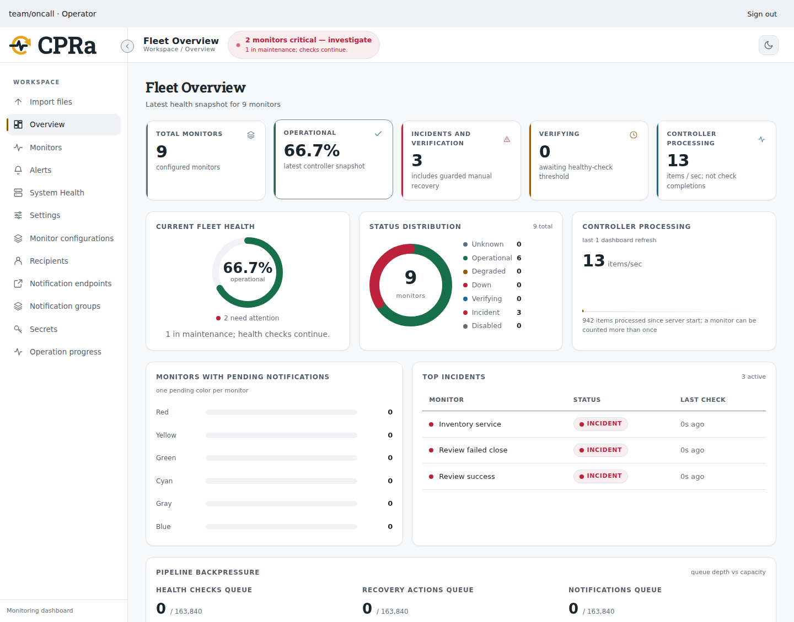

<p align="center">
  <picture>
    <source media="(prefers-color-scheme: dark)" srcset="brand/dist/svg/cpra-horizontal-dark.svg">
    
  </picture>
</p>

<p align="center"><strong>Continuous Pulse and Recovery Agent</strong><br>
Checks services, sends alerts, and runs the recovery actions you configure.</p>

<p align="center">
  <a href="https://github.com/ziad-hsn/cpra/actions/workflows/ci.yml"></a>
  <a href="LICENSE"></a>
  <a href="go.mod"></a>
  <a href="https://ziad-hsn.github.io/cpra/"></a>
</p>

CPRa monitors services and runs the recovery actions you configure. One Go
process schedules checks, tracks incidents, sends notifications and exposes a
React dashboard, an HTTP API and the `cpractl` command-line client. Use files for
read-only operation or named management access to edit monitors, notification
receivers, groups and secrets through the dashboard, API or Go SDK.

## Availability

**CPRa is in development; the first qualified release is not published.** Build
this checkout using the instructions below. [Versions and availability](docs/versions.md)
lists supported source interfaces, tested environments and distribution status.

[Documentation](docs/index.md) · [Quickstart](docs/tutorials/quickstart.md) ·
[Configuration](docs/reference/config-schema.md) · [Drivers](docs/reference/jobs-reference.md) ·
[API](docs/reference/api-reference.md) · [Go SDK](sdk/go/README.md)

The [published website](https://ziad-hsn.github.io/cpra/) is updated separately;
use documentation from the same checkout as your executable.

## What CPRa does

- Runs health checks at a configured cadence with unhealthy and healthy thresholds.
  Incident and action timeline events are retained for 30 days; ordinary completed
  action records remain for 90 days when nothing depends on them. Unknown outcomes
  and review evidence are protected. Raw checks are not retained.
- Commits incident state and action intent to single-node Raft before dispatch.
  Restarts retain confirmed outcomes and hold ambiguous interventions for review.
  Health observations continue while a conflicting intervention is held.
- Sends notifications to configured destinations and can restart containers,
  call a webhook, operate designated Kubernetes workloads, reboot EC2 instances,
  restart systemd units or ask an A2A agent to investigate.
- Supports acknowledge, dismiss, snooze, disable and Ignore as distinct controls.
  Ignore continues checks while suppressing ordinary alerts and interventions;
  verified recovery from a qualifying outage clears it. Ignore applied while
  healthy waits for a later outage or explicit Unignore. Optional automatic Ignore
  uses an explicit outage count and rolling window. Gray notices describe actual
  enable/disable changes; configured blue notices request review of an uncertain
  recovery action without treating health recovery as proof of its outcome.
- Lets operators apply collections from files, directories or explicitly requested
  URLs. Validation precedes activation; operation receipts preserve progress and
  item failures. Interrupted application requires explicit continuation.
- Reports observed health, action outcomes, queues, worker saturation and measured
  SLO attainment. Worker sizing starts with Erlang C/Allen–Cunneen and adjusts
  within configured bounds. Percentiles and targets are measurements, not an SLA.



Dashboard demonstration with synthetic monitor data. See the quickstart to
create your own monitors and notification destinations.

## Build and run locally

Install Go 1.26.10 or Go 1.27.3 (or a newer supported, patched release), Make and
Python 3. Go 1.27.0–1.27.2 remain affected by
[GO-2026-6809](https://vuln.go.dev/ID/GO-2026-6809.json), despite satisfying the
module's minimum-version comparison. The checkout includes the embedded
dashboard; Node and pnpm are needed only when its build inputs change.

```sh
make
export PATH="$PWD/bin:$PATH"
cpra -version
cpractl version
cpractl local init --management
# For a different local listener, use: cpractl local init --management --port 8443
```

Make generates an ignored `bin/cpra-sdk.work` containing the application, SDK and
worker modules. It respects an explicitly selected `GOWORK`, including `off`.
Do not publish module tags or edit dependency versions to work around development
workspace setup. See [contributor setup](CONTRIBUTING.md) for direct Go commands
and editors.

Initialization creates an empty manifest, a named operator token and hash policy,
a wrapping key, localhost TLS certificates and runtime settings in
platform-standard locations. It configures a notification-log directory, which
the server creates with private permissions at startup. It prints exact start and client
commands, never the bearer value. It refuses existing files and starts no service.
System installation requires a protected operator-token output outside
service-owned configuration and state.

Use the printed server command. Trust the generated local CA explicitly in your
browser, open the printed Browser URL (`https://localhost:8060` by default), and
sign in with the token from its protected file. The CLI uses `--server`, `--ca-file` and `--token-file`; the corresponding
`CPRA_SERVER`, `CPRA_CA_FILE` and `CPRA_AUTH_TOKEN_FILE` variables make connections
repeatable. Keep token values out of URLs and command arguments.

Follow the [quickstart](docs/tutorials/quickstart.md) to run a local HTTP target,
validate and apply `examples/monitors.yaml`, inspect `monitor/example-service`,
and restart against the same state. Management imports bootstrap configuration
once; later edits require explicit `apply`. SIGHUP reports that reload is
unsupported; SIGINT and SIGTERM begin graceful shutdown.

## Drivers and configuration

| Function | Default build | Additional built-in tags |
| --- | --- | --- |
| Checks | HTTP, TCP, ICMP, DNS, UDP, TLS, Docker, gRPC | `redis postgres mysql mongo rabbitmq kafka` |
| Recovery | Docker, HTTP webhook, A2A | `kubernetes aws systemd` |
| Notifications | Log, Slack, PagerDuty, email, webhook, Telegram, Discord, Opsgenie, Mattermost, VictorOps, Pushover, Datadog, A2A | `teams twilio` |

```sh
make BUILD_TAGS='redis postgres kubernetes'
cpra -capabilities
cpra -validate -yaml examples/monitors.yaml -runtime-config /absolute/path/from/init/runtime.yaml
```

Replace the runtime path with the one printed by initialization.
Validation checks schemas, references and compiled capabilities without opening
storage or contacting targets. File log notifications require a process-configured
root directory; monitor files select paths inside it. An omitted filename writes
to stdout. Pass the initialized runtime
configuration when validating a manifest that uses log notifications.

TLS checks verify certificates by default. The explicit per-monitor
`insecure_skip_verify` option disables certificate-chain and hostname verification
only for that monitor. It does not disable recovery health checks or API
authentication. Configured certificate-expiry checks still run.

The gRPC check defaults to TCP reachability; `mode: health` calls the gRPC health
service and requires `SERVING`. MongoDB SRV discovery, Kubernetes exec credential
plugins and SMTP username/password authentication are currently unsupported.
[Driver reference](docs/reference/jobs-reference.md) describes required settings,
transport choices, deadlines and platform restrictions.

The separately tagged [external-worker library](sdk/go/worker/README.md) runs
operator-owned Go handlers outside CPRa. It requires `externaljobs` on both sides,
explicit server enablement and scoped credentials. It is not a sandbox for
untrusted code.

## Persistence, operation and safety

User and system installations have different platform-standard paths. Linux
system services explicitly store state in `/var/lib/cpra`; containers and Helm
require retained storage. Use `cpractl local paths` to inspect local defaults.
Explicit `-data-dir` wins over runtime configuration and user defaults. A legacy
working-directory `cpra-data` requires an explicit path or stopped migration.

Single-node Raft provides durable state, not cross-instance failover. Keep one
owner per store. A complete stopped backup includes node identity, Raft data,
snapshots, history and collection generations. Storage errors stop unsafe
admission; restoring or repairing state is an explicit operator action.

Recovery attempts are limited per incident by `intervention.max_attempts`
(default one). Successful action completion means health verification is pending.
Only the configured healthy threshold confirms recovery. An unknown delivery
holds that delivery, without suppressing unrelated later incidents or destinations.
Transport acceptance alone does not prove delivery to a person.

New notification conditions remain pending while relevant. Their captured execution
budget starts with the first committed start after capacity becomes available.
Ordinary built-in notifications have 45 seconds across at most three attempts;
only proven transient failures with no external effect can retry. Neither a
restart nor exhausted retries starts another budget. A pending recovery notice
can report the original outage's recovery after maintenance, using its original
destination. Delivery acceptance does not prove provider resolution.

If local preparation fails, such as an unreadable CA file, current health is
`unknown` and monitoring is unavailable. The last real health observation and its
timestamp remain visible separately. CPRa retries preparation at the normal
cadence without treating a local configuration failure as a target outage.

Configuration authors can choose destinations and actions using the process
account's permissions. Treat them as trusted operators. Management is not a
multi-tenant security boundary. Use [management startup](docs/management-startup.md)
for HTTPS, authority, credential storage and rotation.

[Native installation](docs/native-installation.md) ·
[Containers and Helm](docs/container-helm.md) ·
[Backup and recovery](docs/durability.md) · [SLOs](docs/slo.md)

## Development and verification

```sh
make dev-workspace
make test-fast
make check
make test-all-drivers
make sdk-check
```

`test-fast` is a short edit/test loop. Full race, process, browser, build-tag and
release matrices remain separate. Root `go test ./...` excludes nested modules.
The [contributor guide](CONTRIBUTING.md) covers tools, generation and verification.

The [provider verification guide](docs/provider-testing.md) separates local
fixtures, provider acceptance and independently observed effects. Unconfigured
accounts remain unverified. The [release guide](docs/release-engineering.md)
describes reproducible artifacts and private qualification gates. Passing a
source test does not authorize publication or establish a capacity claim.

## License and community

Code is [MIT-licensed](LICENSE). CPRa-authored artwork by Ziad Hassan uses
[CC BY 4.0](brand/ATTRIBUTION.md), with a separate name and endorsement note.
Third-party licenses remain in the [dashboard notices](LICENSES/dashboard.txt)
and packaged dependency notices.

Read [CONTRIBUTING.md](CONTRIBUTING.md), [SECURITY.md](SECURITY.md) and the
[code of conduct](CODE_OF_CONDUCT.md). Support is through voluntary donations;
there are no subscription-only features or promised response times.
